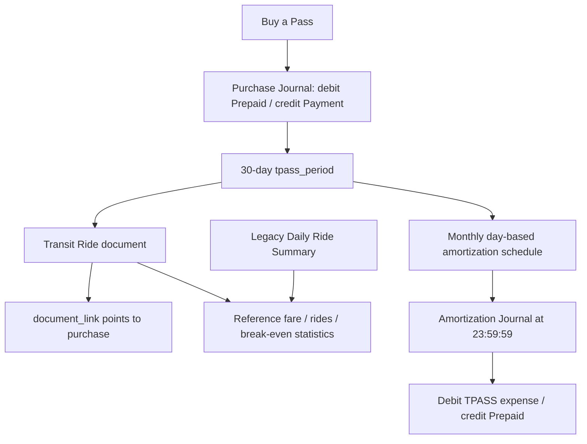

# TPASS 系統使用規則與開發交接文件

> 對象：接手此專案的 Codex／開發者。更新日期：2026-10-22（Asia/Taipei）。
> 本文件以當下原始碼為準，涵蓋使用規則、帳務、API、資料模型、UI 與測試。
> 當前 schema version：34。這是應用程式的實作說明，不代表外部運輸公司的最新票價或適用規則。
> 閱讀後若要修改功能，先重新核對原始碼。不要把「已知限制」當成應延續的產品需求。

## 1. 接手先讀：不可破壞的核心規則

1. 購票、搭乘、費用攤銷是三件不同的事。
2. 購票才建立付款分錄：借記預付費用、貸記付款科目。
3. 正常 TPASS 逐筆搭乘只建立 `Transit Ride` 憑證，並連結到原購票分錄；**不新增財務分錄、不逐次扣預付費用**。
4. 原票價（Reference Price／Reference Fare）只用於回本統計，不能當成 TPASS 每次實際支出的金額。
5. 費用按月票有效天數分配，每月底自動入帳；最後一個月在到期日攤銷剩餘金額。
6. TPASS 自動攤銷分錄時間固定為 `23:59:59`；既有攤銷時間已透過 migration 更新。
7. 使用者不需要按 `Close Period`。
8. 新增搭乘一律使用逐筆 `Transit Ride`。舊 `Daily Ride Summary` 保留歷史顯示與統計，但不得恢復新增、加減或編輯按鈕。
9. 修改、刪除搭乘紀錄不得改動購票或攤銷的日期、時間、科目、借貸金額。
10. 所有資料關係使用永久 ID。科目顯示名稱可改，不可因此斷開綁定。
11. 使用者要求主要操作 UI 使用英文，維持既有緊湊字體與尺寸。現有部分中文文字是尚未統一的實作現況，不是新增中文 UI 的理由。
12. 不要直接修改使用者帳簿 SQL 來試功能；使用隔離測試帳簿。正式資料更動應走既有交易、驗證、備份與 migration 流程。

## 2. 概念與資料流



| 名稱 | 用途 | 是否改變財務分錄 |
| --- | --- | --- |
| Pass period | 月票啟用日、到期日、成本、購票分錄 | 本身不是一筆費用 |
| Purchase Journal | 月票購買及付款 | 是 |
| Transit Ride | 業者、起點、終點、時間、原票價、附件 | TPASS 專用入口新增時，不新增財務分錄 |
| Reference Price | 不使用月票時的參考票價 | 否 |
| Wallet Charge | 額外電子錢包扣款，用於扣減節省估計 | 統計欄位本身不會自動產生費用分錄 |
| Amortization Journal | 期間費用認列 | 是 |
| Daily Ride Summary | 舊版日期、次數、單次票價摘要 | 否；保留既有資料 |

## 3. 使用者操作：購票與建立期別

### 3.1 建議流程：`TPASS → + Buy a Pass`

表單欄位：

| UI | 輸入／行為 |
| --- | --- |
| Pass Name · optional | 月票名稱；UI 預設「基北北桃 1200」 |
| Purchase Date | 實際付款日，不得晚於啟用日 |
| Activation Date | 實際啟用日，不是固定採購日或自然月第一天 |
| Pass Cost · NT$ | 正整數，通常 1200；實作沒有強制金額只能是 1200 |
| Prepaid Expense Account | Active、A、function = Prepaid Expense |
| Paid From | Active A/L 科目；不能是 Contra Asset、Required tracking 科目或同一預付科目 |
| Journal Description · optional | 空白時後端使用 `TPASS Pass Purchase` |
| Note · optional | 購票備註 |

按 `Record Purchase`，同一個交易內完成：

1. 驗證帳戶、金額與日期。
2. 計算 `end_date = start_date + 29 天`，含首尾共 30 天。
3. 驗證期別不與任何已存在期別重疊。
4. 建立購票 Journal 與借貸 line。
5. 寫入 `metadata.tpass_account_id`。
6. 建立 `tpass_period`，以 `funding_journal_id` 指向購票分錄、`funding_required = 1`。
7. 寫入 audit。

任一必要步驟失敗，整筆回滾，不可留下孤立購票或期別。

### 3.2 已經記過購票分錄：連結既有購票

不要再按 Buy a Pass 付款一次。使用期別設定流程：

1. 若尚未綁定，先用 `Link Prepaid Account` 指定預付科目。
2. 使用 `Set Up a Pass Period`；已有期別且尚未攤銷時可用 `Edit Period`。
3. 輸入啟用日，選擇 `Purchase Journal Entry`。
4. 成本取該筆 Journal 對綁定預付科目的**淨借方**，不是手填另一個成本。

候選購票分錄須為 `kind = Normal`，且對綁定科目的 `SUM(debit-credit) > 0`。
購票日期不得晚於啟用日。同一購票分錄不得綁兩個期別。

### 3.3 未綁定科目的歷史模式

`saveTPASSPeriod` 仍支援尚未綁科目時手填成本建立統計期別。這種舊式期別沒有有效購票連結，不能當成完整自動攤銷流程。
`postDueTPASSAmortizations` 會跳過沒有 `funding_journal_id` 的期別；逐筆 TPASS 新增入口也要求有效購票。

### 3.4 日期範例

啟用日 `2026-09-29` → 到期日 `2026-10-28`。
不是 9/29 到 10/29，也不是一律當月底到期。相鄰期別可從 10/29 開始；10/28 再開一個期別會重疊。

## 4. 使用者操作：逐筆搭乘

### 4.1 TPASS 頁面入口

`TPASS → 選擇 Pass Period → + Transit Ride`。

- 今天在所選期別內：預設今天。
- 今天不在所選期別內：預設該期啟用日。
- `openTPASSRide(period,date)` 要求 `period.purchase` 存在且 `cost_verified` 成立。
- 開啟 `documentForm`，帶入 `type = Transit Ride`、`mrt_pass_plan = 基北北桃 1200`、期別 ID 與日期。
- 新增表單鎖定 Document Type 和 payment plan，避免誤建其他憑證。

### 4.2 Journal 入口

`Journal → 選擇搭乘日期 → Transit Ride`。

- 按鈕在 Active 且非 read-only 的 Journal 顯示。
- 使用 Journal 目前查看的 `day`，不是一律今天。
- 先取得 `tpass_report` 的所有期別，找出覆蓋 `day` 的期別，再取得該期報表。
- 沒有覆蓋期別時提示先到 TPASS 建立期別，不會自動建立或猜測購票。
- 此入口是 TPASS 搭乘入口。一般 EasyCard 實際扣款仍走一般交通憑證及平衡分錄流程，不能混為一談。

### 4.3 每筆搭乘應保留的資訊

| 表單／API 欄位 | 規則 |
| --- | --- |
| `date` | 必填且在所選期別內 |
| `mrt_operator` | `AirportMRT`、`TRA`、`TaipeiMetro` |
| `mrt_from_station` | 對應業者站點 ID，不是自由輸入站名 |
| `mrt_to_station` | 對應業者站點 ID，不能與起點相同／同名 |
| `mrt_ride_time` | 可記錄實際搭乘時間；走 normalizedTime 與 validateDate |
| `mrt_train_type` | 對應業者允許的列車種類 |
| `mrt_pass_plan` | 專用入口固定「基北北桃 1200」 |
| `mrt_reference_fare` | 未使用月票時的原票價；非負整數，可留空 |
| `mrt_wallet_charge` | 專用入口必須是 0 |
| `mrt_card_last4` | 若填，必須為四位數；目前 UI 保存行為見 document-editor.js |
| `note`／附件 | 可保留搭乘說明與原始圖片 |
| `tpass_period_id` | 新增專用入口的驗證上下文，並非 ride 表永久期別外鍵 |

一般 Transit Ride 憑證還支援其他 plan，不能因此宣稱 TPASS tracker 同時支援這些月票的完整成本與攤銷。
目前 tracker 的產品計畫固定為「基北北桃 1200」。

### 4.4 儲存結果

`document_save → saveDocument → tpassRidePurchase` 驗證期別、購票、日期、plan、wallet charge 與年度。
儲存 document + airport_mrt_ride 後，`document_link` 連到原購票 Journal。

**這個連結是憑證來源關係，不是複製購票費用，也不是新增一筆零元 Journal。**
即使預付費用帳面餘額已是 0，仍可補登期內搭乘。

## 5. Journal 的搭乘顯示規則

### 5.1 純 TPASS 搭乘卡片

`journalTPASSRides()` 篩選：

- document.type = Transit Ride。
- mrt.pass_plan = 基北北桃 1200。
- 有 Journal link。
- 只連到被辨識為購票的分錄；若已有其他財務分錄代表這趟搭乘，就留在原財務分錄，不重複插一張獨立卡片。

卡片與當日一般分錄按時間合併顯示。無時間項目排在有時間項目之後。

顯示內容：

- `業者完整名稱 · 起點 → 終點`。
- `TPASS` 標籤後緊鄰 `Reference Price NT$ 金額`。
- Reference Price 採和 TPASS 相近的灰綠色，字體大小與粗細接近；不要改回大褐色框或移回副標題。
- `Transit Ride · No additional expense`。
- `View Ride`、`Edit`、`Delete`。
- `Source Entry · 購票日期`，可開啟來源購票分錄。
- Reference Price 未填顯示 `Not provided`，不可偽造 0 或以預設票價替代。
- read-only 不顯示修改與刪除；Archived 卡片不顯示 Edit。

下圖由隔離測試帳簿產生，不含正式帳簿內容。圖中的金額、日期是範例，不是預設值：


### 5.2 EasyCard 實際扣款分錄

若是一般悠遊卡搭乘，例如台鐵楊梅 → 新竹、扣款 NT$64：

```text
借：E - Transportation - TR    64
貸：A - EasyCard ...          64
```

這仍是正常的有金額 Journal，不是 TPASS 純搭乘卡。
Journal `entryTitle()` 必須讀取所連 Transit Ride 的業者及路線，並顯示 `EasyCard` 標籤，不能因為 description 空白而退回 `Journal Entry`。
`Transit Ride` 與 `TRA Ticket` 不同：前者是交通搭乘／電子票證憑證，後者是實體台鐵車票資料模型與票券預覽。

## 6. 搭乘紀錄的編輯、刪除、封存

### 6.1 Edit

Journal 卡片的 Edit 使用一般 `document-edit → documentForm(existing)`。
修改搭乘時間、路線或原票價後，Journal 卡片與報表重新計算；不修改購票與攤銷 line。

**目前限制：**既有紀錄編輯不是 `tpassRidePurchase` 新增流程；不會自動重新綁期別或套用全部新增專用鎖定。
修改日期可能使紀錄落到別期或變成 unassigned，改 plan 可能使紀錄不再屬於 TPASS 統計。
不要在後續開發中假設這些改動已受期別鎖定保護；若新增限制，須明確處理合法的跨期修正並補測試。

### 6.2 Delete

使用 `tpass-trip-delete` 顯示確認框，確認後：

```json
{"id":"<ride-document-id>","action":"delete_tpass_ride"}
```

送到 `document_action → Book.documentAction`。單一交易內：

1. 驗證 document 是 Transit Ride／相容舊 Airport MRT Ride，且 pass_plan = 基北北桃 1200。
2. 若有 PPE link，拒絕。
3. 對每個 Journal link，要求該 Journal 是某個 tpass_period 的 funding_journal_id；若另連一般財務分錄，拒絕。
4. 移除這筆 document 的 links。
5. 檢查無殘留 Journal／PPE links。
6. 移除 attachment references、document；ride 表透過外鍵 cascade 刪除。
7. 寫入 audit。

不刪 Journal、不改 line、不改 tpass_period、不改 tpass_amortization。
刪除後 ride_count、reference_total、回本估計會變動，這是預期結果。
附件 reference 被移除，不代表應直接刪除可能與其他文件共用的底層 blob；儲存生命週期由既有 storage 處理。

一般 `document_action: delete` 仍然禁止刪除已連結文件，不要為了 TPASS 把通用刪除保護放寬。

### 6.3 Archive

目前 tpassReport 查詢包含 Archived 搭乘，並顯示 Archived 標示；**封存不是從統計移除**。
要移除搭乘統計應使用合法刪除流程，而不是假設 Archive 不再計入。

## 7. Daily Ride Summary：歷史相容規則

資料表 `tpass_ride_day` 保存每期每日期的一列摘要：ride_count × reference_fare。

- TPASS 頁面保留日期、次數、單次票價、當日合計。
- 不顯示新增摘要、＋、−、Edit 控制。
- 既有摘要仍納入總搭乘次數與參考票價，不能為了換 UI 清除資料。
- 系統沒有可靠的自動去重鍵。把舊摘要同一批搭乘再逐筆補登會重複計數；不要自動轉換或猜測路線。
- `tpass_ride_add`、`tpass_ride_set` 後端與舊 JS action 仍存在，屬相容殘留；UI 唯讀不等於 API 已禁止修改。
- 若要關閉這些 API，須先盤點 migration、測試與其他入口，不要直接刪表。

## 8. 自動攤銷：日期、金額、分錄

### 8.1 計算方式

`pendingTPASSAmortizations(period,posted)` 以 Gregorian calendar、UTC 做日期運算，避免日數受夏令時間影響。
不是以搭乘次數、回本進度或已搭票價來決定費用。

令：成本 C、含首尾有效天數 D（正常為 30）、某月有效日數 d。

```text
非最後一段金額 = (C × d + floor(D / 2)) / D 的整數除法結果
最後一段金額   = C − 先前已分配金額
```

已入帳月份以實際 posted.amount 參與剩餘計算，不重新覆寫。
每段 amount > 0 才建立分錄；總和應回到成本，尾差由最後一段吸收。

### 8.2 範例

成本 NT$1,200；2026-09-29 啟用，2026-10-28 到期：

| 有效日期 | 天數 | 入帳日期與時間 | 金額 |
| --- | ---: | --- | ---: |
| 9/29–9/30 | 2 | 2026-09-30 23:59:59 | 80 |
| 10/1–10/28 | 28 | 2026-10-28 23:59:59 | 1,120 |
| 合計 | 30 | | 1,200 |

同月內啟用且到期：整筆成本在到期日認列。跨三個自然月時也依同一分段算法，不能硬寫只有兩筆。

### 8.3 借貸科目

```text
借：E - Transportation - TPASS       當期攤銷金額
貸：A - <綁定的預付費用科目>           當期攤銷金額
時間：23:59:59
kind：Normal
description：TPASS Amortization · YYYY-MM
```

expense account 選擇順序：相容 Close API 明確指定 → 本期既有攤銷 expense_account_id → 現有 Active `Transportation - TPASS`（E）→ 自動建立同名 E 科目。
科目必須存在、有效且為 E。不要每次搭乘建立 `Transportation - TR` 費用來取代月末攤銷。

### 8.4 觸發、補記、時間的真正含義

- HTTPServer 的 work queue 上有每 60 秒一次的 timer。
- `Service.state()` 與 `tpass_report` 也會呼叫 `runTPASSAmortization()`。
- readOnly 或 mode != Active 時不自動入帳。
- 程式不執行時沒有作業系統背景服務代跑；重新開啟並取 state／report 或 timer 時，補記到原應入帳日期。
- **23:59:59 是分錄上的時間，不是目前排程器的精確執行時刻。** 到期判斷只有日期 `postingDate <= today`，因此當日較早開啟帳簿也可能先建立帶 23:59:59 的分錄。
- 若日後要求當地時間 23:59:59 之後才真正入帳，必須另改觸發條件與測試，不能宣稱目前已做到。
- `Book.date()` 使用執行環境當地時區；`localDate()` 是前端本地日期。此部署的使用者時區為 Asia/Taipei；跨時區部署需重新確認兩端日期一致。

### 8.5 冪等、交易與錯誤

- `tpass_amortization` 的 `(period_id,month)` 是 primary key，journal_id 唯一。
- 重複刷新／timer／重開應不重複建立同月份費用。
- 每個期別的到期分段在該次 `change` 交易中一起提交；多個期別不是全域單一交易。
- 關閉年度、綁定失效或舊扣款衝突時，不可略過驗證強行入帳。
- Service 捕捉錯誤放入 `tpass_automation_error`；report 帶 `automation_error`，UI 顯示原因。
- 一期失敗可能中止當次循環後續期別；先前已成功提交的期別不會因此自動撤回。
- 目前沒有允許使用者任意刪除自動攤銷的入口。

## 9. 舊逐次費用防止重複攤銷

自動入帳前，對綁定預付科目、期內日期範圍計算：

```text
legacyCredits = SUM(credit − debit)
排除本期購票 Journal
排除所有已登錄在 tpass_amortization 的 Journal
```

必須 `legacyCredits == 0`，否則拒絕。

歷史上曾有逐次搭乘費用消耗整筆 1200 的資料，使用者授權的轉換做法是：保留搭乘證據、另外建立沖回舊逐次費用的分錄，再採月末／到期日攤銷。不要直接刪除原費用歷史或再攤銷一次。

此條件是淨額檢查，不是精確辨識每個 Journal 的用途；其他預付異動也可能觸發。`legacyCredits != 0` 包括負數，不能簡化成「只檢查是否有正貸方」。

## 10. 財務修改保護與餘額含義

- 期別一旦存在 amortization，就不能用 `saveTPASSPeriod` 修改啟用日等欄位；UI 不顯示 Edit Period。
- 已有攤銷的購票分錄不能編輯／刪除；自動攤銷 Journal 也不能一般編輯／刪除。
- 錯誤應使用合適調整分錄與受控修正，不要清掉關聯表繞過鎖定。
- 尚未攤銷的購票修改會影響候選 purchase 與 report 的成本驗證；不代表任意修改後所有 period 儲存值都已同步。自動入帳仍會核對成本。
- 預付剩餘餘額是綁定 account 的實際 `SUM(debit-credit)`，涵蓋全部期別及其他 Journal，不是單一期的 `cost-amortized_total`。
- 頁面「已攤銷」與「下次攤銷」是所選期別；「Book balance／預付費用剩餘餘額」是整個綁定科目。
- 改科目名稱不會斷開；已有 funding_required=1 期別時不能隨意換綁其他科目。

## 11. 回本統計規則

令 R = 已知逐筆 reference_fare 合計 + 舊摘要 `ride_count × reference_fare`；W = 額外 wallet_charge 合計；C = 期別成本。

```text
ride_count      = 符合條件的逐筆數 + 歷史摘要次數
reference_total = R
wallet_total    = W
avoided_fare    = R − W
net_savings     = R − W − C
remaining       = max(0, C + W − R)
break_even      = net_savings >= 0 且 cost_verified
complete        = missing_fares == 0
```

- reference_fare 空白／NULL 是未知，missing_fares +1；0 是已知零元，不是 missing。
- 缺票價時，只能說「已知票價」估計／Known rides，不可宣稱全部精確統計。
- 逐筆須至少連到一個 Journal 才被 tpassReport 納入；單獨未連結憑證不計數。
- tpassReport 以搭乘日期是否落在期別範圍歸屬，不是以購票 Journal 日期歸屬。
- 現行 query 沒要求所有被計入的舊憑證都連到該期購票；專用新增入口才保證這個關係。
- `unassigned_count` 表示已連 Journal 的 TPASS 搭乘日期不在任何期別。
- break_even_date 依日期累加事件；同日事件沒有作為產品承諾的精確跨業者時間排序。UI 只應作日期參考。
- 回本不會提早攤完預付費用；沒搭車也仍按有效日數攤銷。

## 12. 資料表與關係

### 12.1 metadata

`key = tpass_account_id` 的 value 為永久 account.id。

### 12.2 tpass_period

主要欄位：id、name、plan、start_date、end_date、cost、modified_at、funding_journal_id、funding_required。
購票外鍵刪除規則見 Schema.swift；不要只依賴外鍵作業務保護，Journal.swift 有更嚴格驗證。

### 12.3 tpass_amortization

主要欄位：period_id、month（YYYY-MM）、journal_id、amount、expense_account_id、modified_at。
primary key = `(period_id,month)`，journal_id UNIQUE。

### 12.4 document、airport_mrt_ride、document_link

`airport_mrt_ride` 雖然名稱保留機捷字樣，實際承載 AirportMRT、TRA、TaipeiMetro 共用的 Transit Ride。
`document_id` 為 primary key、連 document ON DELETE CASCADE。
`reference_fare` 可 NULL；其餘路線、時間、車種、plan、wallet、seller 資訊在 ride 表。
`document_link(document_id,journal_id)` 為複合 primary key。新 TPASS ride 指向購票，沒有新的 Journal line。

### 12.5 tpass_ride_day

primary key = `(period_id,date)`。只應保存舊摘要相容資料，不是新的逐筆模型。

### 12.6 migration

查閱 `Migration.swift` 的版本映射，key N 表示從 N 升到 N+1，不可看錯：

| Migration key | 用途 |
| --- | --- |
| 15 | TPASS period 與 reference_fare 支援 |
| 16 | funding_journal_id / funding_required |
| 21 | tpass_ride_day / tpass_amortization |
| 32 → schema 33 | 既有 TPASS 攤銷 Journal 時間改成 23:59:59，audit 保留舊時間 |
| 33 → schema 34 | 折舊時間統一；不是 TPASS 計算變更 |

目前 schema 34。新增 migration 必須保留備份、失敗還原與完整性檢查，不要直接提高版本號而不加入升級邏輯。

## 13. API 交接

Service 使用 POST `/api/<action>`、JSON body；本機 HTTP API 需要 `X-kAccounting-Token`，取自頁面 meta `app-token`。
一般回應包裝為 `data`，錯誤為 `error`；具體前端 `api()`／Service dispatch 為準。
不要在文件、log 或提交中寫死正式 token。

| Action | 主要 input | 結果與注意事項 |
| --- | --- | --- |
| tpass_configure | account_id | 綁預付科目；已有正式期別限制換綁 |
| tpass_buy | cost,purchase_date,start_date,prepaid_account_id,payment_account_id,name,description,note | 原子建立 Journal + period，回傳 period_id / journal_id |
| tpass_period_save | id?、start_date、funding_journal_id、name、cost（僅未綁科目模式） | 建立／更新期別，回傳 id |
| tpass_report | period_id? | **可能先觸發自動入帳**，不是完全無副作用的純讀取 |
| document_save | Transit Ride 欄位、tpass_period_id（新建專用） | 回傳 document id，自動 link 購票 |
| document_save | id + 既有憑證欄位 | 一般編輯，不是期別重綁 API |
| document_action | id,action=delete_tpass_ride | 受控刪除 TPASS ride，不刪購票／攤銷 |
| tpass_ride_add | period_id,date,reference_fare | 相容舊摘要 +1，UI 不再提供 |
| tpass_ride_set | period_id,date,ride_count,reference_fare | 相容舊摘要覆寫；count=0 刪摘要列 |
| tpass_close | period_id,expense_account_id? | 相容 API，期別已到期才可呼叫；UI 不再提供 |
| state | 無 | 也會嘗試自動攤銷，回傳 book snapshot 與 automation error |

### 13.1 新購票範例（ID 皆為測試 placeholder）

```json
{
  "name":"基北北桃 1200",
  "purchase_date":"2026-09-29",
  "start_date":"2026-09-29",
  "cost":1200,
  "prepaid_account_id":"<prepaid-account-id>",
  "payment_account_id":"<bank-or-cash-id>"
}
```

### 13.2 新逐筆搭乘範例

```json
{
  "type":"Transit Ride",
  "date":"2026-10-07",
  "tpass_period_id":"<period-id>",
  "mrt_operator":"AirportMRT",
  "mrt_from_station":"A22",
  "mrt_to_station":"A18",
  "mrt_ride_time":"09:16:00",
  "mrt_train_type":"Commuter",
  "mrt_pass_plan":"基北北桃 1200",
  "mrt_wallet_charge":0,
  "mrt_reference_fare":35
}
```

此範例表示「桃園大眾捷運股份有限公司 · 老街溪 → 高鐵桃園站」。35 僅為測試輸入，不是本文件查證過的官方票價。

### 13.3 report 重要欄位

- `periods`：所有期別，包含 purchase、cost_verified、amortizations、amortized_total、next_amortization。
- `period`：指定 ID，其次當前有效期，再其次最新期；沒有期別時為 null，不能直接當 object 讀。
- `account_id / account`：綁定預付科目與實際 book balance，account 可 null。
- `purchases`：可辨識的購票候選。
- `rides / daily_rides`：逐筆與歷史摘要。
- `reference_total / wallet_total / avoided_fare / net_savings / remaining`。
- `ride_count / missing_fares / complete / unassigned_count / break_even / break_even_date`。
- `automation_error`：Service 補入的自動入帳錯誤字串。
- `next_amortization` 是 `{month,date,amount}` 或 null；不是實際 timer 執行時間保證。

## 14. 程式入口地圖

路徑均相對 repository root。

| 路徑 | 責任 |
| --- | --- |
| Sources/AccountingCore/TPASS.swift | 購票、期別、排程、入帳、回本報表、舊摘要 |
| Sources/AccountingCore/AirportMRT.swift | Transit Ride 欄位及 seller 儲存驗證 |
| Sources/AccountingCore/TransitRides.swift | 業者、站點、車種、TPASS 台鐵站點名單 |
| Sources/AccountingCore/Documents.swift | 憑證儲存與自動連購票；delete_tpass_ride |
| Sources/AccountingCore/Journal.swift | Journal 寫入／刪除；TPASS 購票與攤銷保護 |
| Sources/AccountingCore/Schema.swift | 真正 SQL 欄位、constraints 與版本 |
| Sources/AccountingCore/Migration.swift | 舊帳簿升級與時間修正 |
| Sources/AccountingCore/Book.swift | 日期、writable、change 交易與儲存同步 |
| Sources/KAccounting/ServiceTransitActions.swift | TPASS API dispatch |
| Sources/KAccounting/ServiceDocumentsActions.swift | document API dispatch |
| Sources/KAccounting/Service.swift | 自動入帳錯誤保存、state |
| Sources/KAccounting/HTTPServer.swift | 60 秒 timer 與工作 queue |
| Sources/KAccounting/Web/features/tpass.js | TPASS 頁、購票／期別表單、Journal 新增入口、Delete 確認 |
| Sources/KAccounting/Web/features/journal-list.js | 純搭乘卡片、標題、EasyCard badge、日期 timeline |
| Sources/KAccounting/Web/features/document-editor.js | Transit Ride 表單編輯、附件、儲存 |
| Sources/KAccounting/Web/features/transport.js | 業者站點表單、plan 提示、搭乘及票券輔助功能 |
| Sources/KAccounting/Web/styles/workspace.css | 現行全站字級與 TPASS Reference Price 樣式覆寫 |
| Sources/KAccounting/Web/index.html | script／style 載入順序 |

這個前端是以共享 globals 與 action registry 組成的 classic scripts。新增函式或 command 要檢查重名及 registry，不能當成任意 ES module 直接改。

## 15. 已知限制、易踩雷處與後續開發判斷

| 現況 | 接手開發應注意 |
| --- | --- |
| 日期到期就可能建立 23:59:59 分錄 | 不等於晚上精準 23:59:59 才執行 |
| state / report 會觸發入帳 | 查正式帳簿也可能改帳；驗證用隔離帳簿 |
| daily summary 舊 API 還在 | 不要重新露出舊 UI；關閉 API 需另做相容設計 |
| Edit 使用通用文件表單 | 日期／plan／type 修改的跨期影響尚未完全鎖定 |
| Report 按日期歸期、要求任一 Journal link | 不代表資料永久綁定該 period.id |
| Archived rides 仍計數 | Archive 和 Delete 語意不同 |
| 通用 ride 支援其他 plan | 不代表 tracker 已支援其他月票成本／攤銷 |
| UI 有 TPASS 適用範圍提示 | 不要假設所有前端提示都已有後端相同強度的驗證 |
| backend station 名單是程式常數 | 未重新查證外部規則前，不宣稱最新官方適用範圍 |
| TPASS 預付科目為全帳簿單一綁定 | 多卡、多方案、多預付帳戶並存需要模型改造 |
| 傳入金額使用整數、無小數貨幣 | 保留 Int64／安全範圍驗證，不以浮點改寫財務邏輯 |
| pending 計算有 `cost × days` | 若擴大可輸入成本範圍，重新審核 Int64 乘法上溢 |
| global CSS 使用 font-size!important | 新標示須檢查 computed style；避免再發生 Reference Price 過大或不一致 |
| 部分歷史 smoke scripts 保留舊文案／舊入口 | 執行失敗要判斷是回歸或測試過時，不能藉恢復舊功能來讓測試變綠 |

前端可透過 period 名稱顯示中文資料，但新按鈕／提示文字應延續使用者要求的英文。
產品尚未完整統一所有舊中文文案；若要統一，屬另一次 UI 工作，不要在財務修正中順手大改字級／顏色。

## 16. 開發與驗證

### 16.1 環境

- Swift package、AccountingCore + KAccounting web server。
- 通常使用 `.build-v1/debug/KAccountingSuper`，由 `--home <isolated-home> --port <isolated-port>` 啟動。
- `scripts/lib/isolated-app.mjs` 提供隔離帳簿、API、WebKit page 與錯誤收集。
- `scripts/lib/runtime.mjs` 支援 `KACCOUNTING_BINARY` 覆寫執行檔。
- macOS XCTest 使用完整 Xcode；CommandLineTools 單獨環境可能缺 XCTest。

```sh
swift build --scratch-path .build-v1
DEVELOPER_DIR=/Applications/Xcode.app/Contents/Developer swift test --scratch-path .build-health --filter 'AccountingTests.testTPASS'
node scripts/architecture-check.mjs
node scripts/tpass-trip-smoke.mjs
node scripts/transit-entry-title-smoke.mjs
```

若 PATH 沒有合適 node，查找目前環境的 bundled Node，不要將某台機器的長絕對路徑寫成唯一可用的開發設定。
不要平行啟動寫入同一 Swift scratch path 的多個 build／test。

### 16.2 Swift 測試定位

| 測試檔 | 主要覆蓋 |
| --- | --- |
| TPASSTests.swift | 回本、未知票價、多業者、日期與舊 migration |
| TPASSBindingTests.swift | 科目／購票關係、來源、成本、舊資料 |
| TPASSDirectRideTests.swift | 零餘額仍可記錄；自動 link；失敗原子性、readOnly、年度 |
| TPASSAutomaticAmortizationTests.swift | 月底／到期、冪等、尾差、補記、關年、舊逐次費用防重、時間 migration |

### 16.3 現行專用 browser smoke

`scripts/tpass-trip-smoke.mjs` 覆蓋：

- TPASS 頁 + Transit Ride 表單與路線儲存。
- 購票與攤銷 Journal line 不變、預付餘額不變。
- Reference Price 在 TPASS 旁，computed font-size 和 TPASS 相同。
- 歷史摘要有資料，但沒有新增／加減／編輯按鈕。
- Journal 日期帶入正確期別；read-only 隱藏入口。
- Edit 改路線、原票價。
- Delete 確認與刪除後統計變化。
- 另連一般財務分錄時刪除被拒絕。

`scripts/transit-entry-title-smoke.mjs` 覆蓋台鐵 EasyCard 有金額分錄的業者／路線標題與 EasyCard badge。
其他既有 tpass-*.mjs 是輔助回歸資產，但部分可能依賴舊文案，應逐一審核。

### 16.4 每次修改的最低驗收清單

1. 購票只記一次，期別日期含首尾 30 天，重疊被拒絕。
2. TPASS 逐筆新增後 Journal 數量與所有借貸 line 不變，只有 document/link 等證據增加。
3. 原票價變動只改回本估計，不改費用。
4. 月底與到期日金額正確，時間 23:59:59；重複執行不重複費用。
5. 回本與預付餘額顯示來源分清楚，零餘額能補搭乘。
6. Edit／Delete 只變證據及統計，購票、攤銷和現有科目餘額相同。
7. 刪除帶其他財務／PPE links 的紀錄被拒絕且不產生部分刪除。
8. 歷史 daily summary 沒被移除或重複轉換，UI 仍無修改控制。
9. Journal 新增按鈕採查看日期；TPASS 頁採所選 period。
10. readOnly、Setup、關閉年度與失效關係有正確保護／錯誤提示。
11. 無缺失 action registration、重複 globals 或 browser pageerror。
12. 針對 UI 變更查看實際截圖與 computed style，不只看 HTML 字串。

## 17. 部署與交接方式

1. 先完成隔離測試並編譯成功。
2. 若更動資料模型／既有資料，設計有備份與回滾的正式 migration。
3. 確認使用者目前開啟的帳簿，不要假設名為 FirstBook；不要憑過往對話路徑直接改另一個檔案。
4. 正式重啟前先透過既有 close 流程 flush；啟動新版本再開回原帳簿。
5. 驗證是否可寫、schema、分錄日期／借貸及科目餘額。若任務只改顯示，財務資料應完全相同。
6. 不要把 `/tmp` 中某次對話的重啟腳本、PID 或 token 當成正式部署介面；它們不是長期穩定依賴。
7. 未經任務授權不要替正式帳簿新增測試搭乘、摘要、調整費用或重建購票。

## 18. 快速故障排查

| 症狀 | 先查 |
| --- | --- |
| Journal 顯示 Journal Entry | documents 是否連結、是否有 mrt 明細；entryTitle 是否處理 Transit Ride |
| 有憑證但回本沒增加 | 是否是基北北桃 plan、至少一個 Journal link、日期在期內、reference 是否 NULL |
| 回本金額重複 | 舊 daily summary 是否又逐筆補登；同一趟是否重複建 document |
| 零餘額不能記搭乘 | 是否誤把 prepaid balance 當新增驗證，而非只檢查購票／日期／年度 |
| 沒自動攤銷 | Active/writable？購票有效？到 posting date？automation_error？年度是否關閉？ |
| 重複費用 | 先核對 tpass_amortization 與舊逐次費用；不要直接再補一筆 |
| 無法修改購票／期別 | 已有攤銷時是預期保護，不是 UI bug |
| 無法刪搭乘 | PPE link／非購票 Journal link／不是基北北桃 plan／read-only |
| Archive 後回本未減少 | 現況仍計入 Archived，刪除才移除統計 |
| 切換期別，預付餘額一樣 | 正常，balance 為全帳簿綁定科目的餘額 |
| Reference Price 字體／顏色跑掉 | workspace.css 全站 !important 與局部覆寫優先順序 |
| 舊帳簿開啟失敗 | 看 migration diagnostics、Pre-Migration Backup 與完整性檢查；勿直接跳過版本 |

---

### 交接給下一個 Codex 的第一句話

請先讀本文件及列出的程式入口，區分「產品規則」與「目前實作限制」。TPASS 搭乘是證據，月票費用由自動攤銷認列；所有修改先在隔離帳簿驗證，確保購票、攤銷與帳戶餘額不受非財務操作影響。
