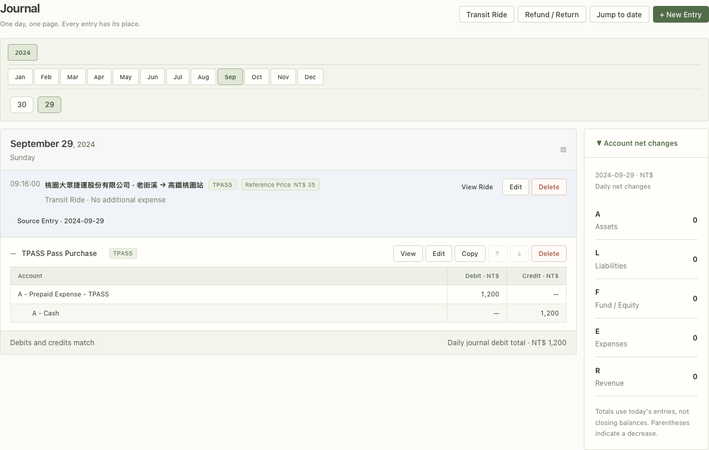

# TPASS Future Feature

Status: confirmed future requirement; not implemented.

The user identified TPASS tracking as a frequently used workflow that should be added in a later phase. This document captures the product intent supplied in `TPASS_DEVELOPER_GUIDE.md` without treating that other project's implementation details or known limitations as instructions for this codebase.

## Product intent

The feature should keep these three events distinct:

1. Buying a pass creates the financial transaction.
2. Recording a ride preserves evidence and supports usage statistics.
3. Amortizing the pass recognizes expense over its valid days.

For a normal purchase, the system posts one balanced entry:

```text
Debit:  Prepaid TPASS expense
Credit: Selected cash, bank, or other valid payment account
```

A TPASS ride does not create another journal entry and does not consume prepaid expense. Its reference fare is the price that would otherwise have been paid; it is statistical information, not the ride's actual TPASS expense.

## Required accounting behavior

- Money uses the project's exact integer-minor-unit representation; no binary floating point.
- Pass purchase and pass-period creation are atomic.
- The purchase date cannot be later than the activation date.
- The initial expected period is 30 inclusive calendar days, so the end date is activation date plus 29 days.
- Pass periods must not overlap when the chosen product/accounting policy makes overlap invalid.
- Only valid active posting accounts may be used for the purchase and amortization entries.
- A ride must be linked through permanent IDs and must not be broken by an account rename.
- Ride creation, editing, archiving, or deletion must not silently edit or delete posted purchase or amortization entries.
- Reports and balances continue to derive from posted journal lines; ride statistics are a separate analytical view.
- Corrections to posted financial entries use the project's reversal or correcting-entry workflow.

## Amortization direction

Allocate the exact pass cost across calendar-month segments in proportion to valid days. Each non-final segment is rounded using an explicitly tested integer rule; the final segment receives the remaining amount so that all segments equal the original cost exactly.

The anticipated entry is:

```text
Debit:  TPASS transportation expense
Credit: Prepaid TPASS expense
```

Automatic posting must be idempotent and transactional. Catch-up after the application was closed must preserve the intended accounting date. The exact local-time trigger remains a user decision.

## Ride evidence and statistics

Each ride should be able to retain:

- ride date and optional time;
- operator, origin, destination, and train type from validated identifiers;
- pass product/plan;
- optional reference fare, where missing differs from a known zero fare;
- optional note and supporting images through the Version 01 attachment store;
- a link to the relevant pass purchase or period.

The analytical view should show ride count, known reference-fare total, missing-fare count, estimated avoided fare, estimated net savings, remaining amount to break even, and an appropriately qualified break-even date. Missing fares must prevent the UI from implying that totals are complete.

Break-even statistics never accelerate or replace amortization.

## UX direction

- Provide a compact TPASS workspace and a ride entry point from the relevant Journal date.
- Use English for primary controls while allowing Chinese account and pass names under the project's mixed-font rules.
- Keep the layout consistent with macOS Catalina light Aqua, compact tables/toolbars, blue selection, and touch-friendly iPad Safari targets.
- Do not implement the Journal-side editor integration until the general journal interaction specification has been approved.

### Journal visual reference



The supplied screenshot establishes the preferred information hierarchy for the future Journal integration:

- a date-oriented Journal with compact year, month, and day navigation;
- a TPASS ride shown as a non-financial evidence row, including time, operator, route, TPASS badge, reference fare, and the explicit message `No additional expense`;
- a visible link from the ride to its source purchase entry;
- the purchase displayed separately in the traditional debit/credit table;
- compact `View`, `Edit`, and `Delete` actions rather than a large card-oriented layout;
- a restrained light Aqua palette with subtle separators and muted green/blue-gray states.

The screenshot is a directional reference, not an approved complete interaction specification. Its example date, route, amount, labels, available actions, and account-net-change values are sample data rather than defaults or accounting policy. Responsive behavior, keyboard operation, touch targets, edit restrictions, confirmation flows, accessibility, and error states still require design review.

## Delivery constraints

- Re-check the current source and schema before implementation; do not transplant Swift paths, API names, schema versions, or timer behavior from the reference project.
- Add tests for every accounting invariant before or with the implementation.
- Use isolated test books and never modify real financial data during development.
- Any migration must provide backup, failure recovery, and integrity verification.
- Treat external fare, operator, station, and eligibility rules as time-sensitive data that require authoritative verification before release.

## Regression example package

The repository includes the user-supplied, de-identified `TPASS_EXAMPLE_PACKAGE/` as test-only source data. `backend/tests/tpass_examples.rs` currently verifies that its account setup is accepted by an isolated in-memory database and that its purchase, ride, amortization, EasyCard, and deletion expectations remain internally balanced and non-duplicating.

The package's original `verify.mjs` targets a different Swift application and is retained only as reference material. It is not part of this project's verification command. Once the Rust Journal and TPASS models exist, promote the same JSON cases into end-to-end repository/API tests; until then, passing fixture-contract tests must not be described as proof that TPASS is implemented.

## Decisions still required

The unresolved product choices are listed in `docs/OPEN_QUESTIONS.md`. Implementation should not silently settle them.
