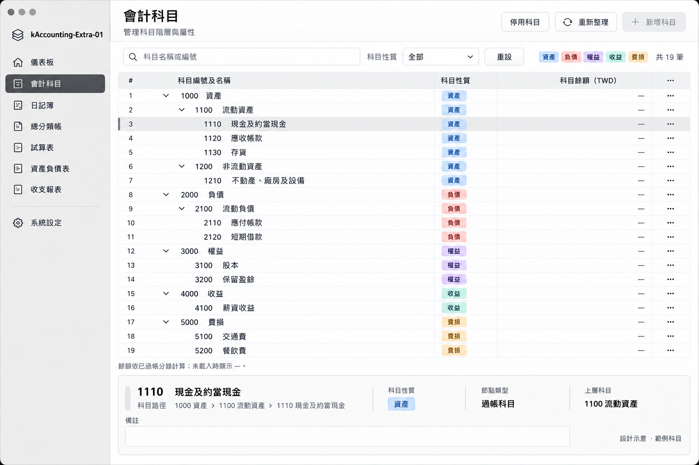

# UI 設計交接 — 2026-10-22

來源對話：**改善 Accounting Extra UI**，ID
`01a16309-91c2-70f0-8ac8-da2b7870791b`。本文件已直接核對該對話全部
10 個回合與原始圖片，不依賴接手者能開啟舊對話。圖檔已保存於儲存庫，
不是連向原電腦的暫存圖路徑。全部都是示意圖，尚未實作或通過 Safari 驗收。

## 最新要求優先於舊稿

使用者先要求參考 SAP、Oracle 的專業會計介面，並明確允許「不侷限 Catalina，
參考 macOS 各個版本」。五個方向中，使用者對 **02 清晰現代** 回覆「這個不錯」。
因此採用其全寬表格與底部摘要結構；助手曾建議 04 搭配 03，但使用者沒有選它。
之後黑白配色、類別色標與欄位修訂優先於 02 舊稿的藍色按鈕／選取底色。
這次只整理文件，沒有把示意圖直接實作為產品。

### 已明確提出的使用者要求

- 顯示正確程式名稱 `kAccounting-Extra-01`。
- 不使用科目資料夾圖案；以階層縮排與展開／收合呈現科目樹。
- 科目編號固定四碼，與名稱合併在同一欄。
- 類別名稱為「資產、負債、權益、收益、費損」，欄名「科目性質」。
- 僅用顏色區分類別，其他介面採黑白灰；金額不以紅綠區分。
- 科目金額用正負號區分，但正負號的具體會計語意仍未定案。
- 停用科目不放側邊欄；入口移至頁面右上工具列，側邊欄只放常用功能。
- 一度要求移除餘額，後來明確要求「把科目餘額也放進去」：最新要求是保留
  一個科目餘額欄。沒有批准將期初餘額等所有歷史欄位一併加回。
- 只畫設計，不寫程式；本次整理不改前端實作。

### 保留的既有約束

緊湊資料密度、白色資料區、清楚格線與對齊；金額靠右、等寬數字。
一般文字使用 system-ui，僅科目名稱內的中文字用 DFKai-SB 及安全 fallback。
保持鍵盤操作、語意表格、明確焦點與非單靠顏色的類別辨識。
Mac Safari 為 Version 01；iPad 介面與實體 APFS/exFAT 驗收在 Version 02。
視覺風格改變不取消會計／資料安全約束。

## 最接近最新要求的示意圖

**此圖不是可以逐像素照抄的最終規格**：圖中表頭「⋯」已被助手辨識為多餘，
應移除；每列「⋯」要先定義實際操作再決定保留。圖中的儀表板、系統設定、
編號／名稱／分類範例與第 19 筆列數，不等於核准了功能、預設科目或資料。
圖中顯示「—」代表未載入，不可偽裝成零，也不是已完成正負號餘額設計。

底部科目摘要、完整路徑、搜尋／篩選與緊湊工具列是已選方向的構成，
具體操作細節與全部狀態仍需實作設計。藍／磚紅／紫／青綠／琥珀色對應五類
是助手提供的示意色方案；使用者要求以顏色區分，但沒有單獨核准色碼。

## 圖稿順序與取代關係

所有原始稿完整保留，避免遺失設計脈絡。較新文字要求優先於圖片瑕疵。

| 圖檔（位於 assets/ui-design-2026-10-22） | 身分與用途 |
| --- | --- |
| `exec-a75a5904-fd0f-46b3-91ac-52ddf18fc011.png` | 初始 Catalina 提案，使用者認為不夠專業，歷史參考 |
| `exec-a398b06d-d242-4c64-b051-7fbc40402c99.png` | SAP／Oracle 風格過渡提案，非最後選定 |
| `exec-684acbe0-fc7e-4678-8b3c-4f033484a576.png` | 01 經典專業，未選 |
| `exec-7f289002-934d-44da-a107-aed13aaa2924.png` | 02 清晰現代初稿 |
| `exec-89f7d149-164e-4499-b4c1-a1541cddc2a9.png` | 02 修訂稿，使用者附此圖回覆「這個不錯」 |
| `exec-9f82d376-4c6e-459a-9b8e-4188f06956f2.png` | 03 財務工作台初稿，未選 |
| `exec-586b3c40-45d4-4e46-80d9-ed3bcec9d9b8.png` | 03 修訂稿，未選 |
| `exec-b76c74df-338b-4cae-882e-53870726db93.png` | 04 沉穩精緻，未選；助手推薦不等於使用者核准 |
| `exec-d8fb0ab3-1879-4843-b89b-d070317f6729.png` | 05 輕透精準，未選 |
| `exec-8f4f3ab6-ac64-4fb7-8ae1-a22c7cd07153.png` | 四碼、合併欄、移除圖案等修改；配色已被後稿取代 |
| `exec-7b6bd051-5bf1-4207-a6cf-08cc59f663a8.png` | 黑白灰＋五類色標；側邊欄停用入口已被取代 |
| `exec-1c3a4c4f-d265-4407-aac6-bd77645cb3e6.png` | 停用入口移至右上；尚未加回餘額 |
| `exec-2297620a-387e-40b5-82fa-4cb4f3aa3d97.png` | 最新圖：加回餘額；表頭⋯仍須移除，信用卡尚未改 |

每個 PNG 的原始 SHA-256 與長度見同資料夾 `manifest.json`，本次沒有重新繪圖。

## 信用卡與核心 API：待決，不得照搬

使用者要求查閱舊版信用卡，並通知核心「邏輯可能要改」。這不等於核准
新政策。舊版清單顯示可用額度，而非一般負債餘額；其公式為
可用額度＝信用額度＋預繳款－未償卡款。這是舊碼證據，不是新帳簿規則。
助手提出信用卡列另標可用額度、底部顯示明細，仍屬建議而非使用者定案。

見 [核心評估](CREDIT_CARD_CORE_REVIEW_2026-10-22.md) 與
[未決事項](OPEN_QUESTIONS.md)。尚需決定一般餘額正負號、信用卡餘額與可用
額度的並列方式、超額／超繳、限額歷史及沖銷。可用額度不得混入試算表／
資產負債表科目餘額。現有核心尚無信用卡 subtype／limit API；四碼科目代碼
也不是目前數值 AccountId，須另外設計，不得截斷 ID 來假裝四碼。

## 新 Mac 下一步

1. 先依 [換機交接](HANDOFF_NEXT_MAC.md) 完成環境與測試，使用拋棄式帳簿。
2. 以本文件最新視覺要求設計主視窗、選簿與科目頁，保留未決政策。
3. 補齊科目餘額／代碼等 API 契約與測試後才接線；不假造金額。
4. 分錄編輯欄位、明確儲存、借貸分欄等已在 VERSION01_DECISIONS.md 核准，
   不要因 AGENTS.md 的一般提醒重新詢問既有核准；新的未決政策仍需確認。
5. 完成附件、報表、備份／移轉操作及 Mac Safari 驗收。不能用這張科目圖
   推定其他畫面完整設計、已實作或已驗收。
